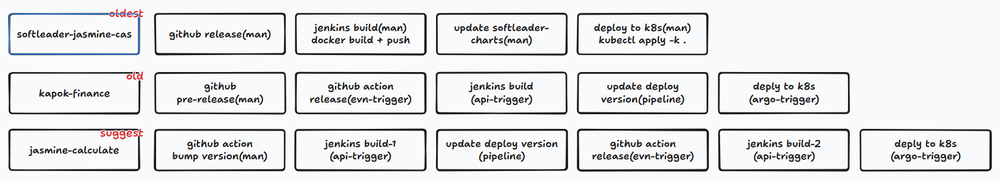
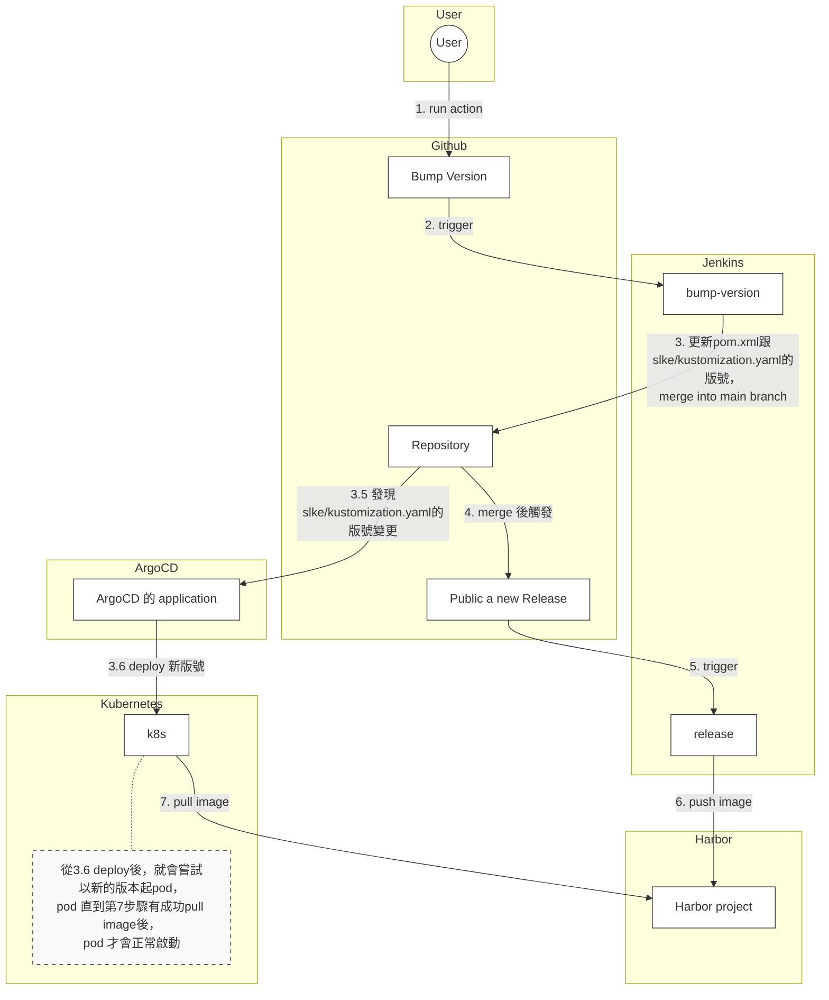

# 講講我們的專案在Github按下Release後都發生了啥事

[錄影檔](https://drive.google.com/file/d/1VdlO4MXt4LE_AYlCREMq6RvQcFfWCCRt/view?usp=drive_link)

# 專案 GitHub Release 流程演進全解析

影片將公司的專案發布流程分為三個階段（三種模式）進行解說，分別代表了從高度人工介入到高度自動化的演變。

## 第一種模式：最古老的流程 (以 `softleader-jasmine-cas` 為例)
這是早期尚未導入完整自動化時的流程，人工介入比例極高，步驟繁瑣。

### 流程步驟：
1.  **GitHub Release (人工):**
    * 開發者在 GitHub 上手動點擊 "Draft a new release"。
    * **注意：** 這個動作僅僅是打了一個 Tag，**不會**自動觸發後續的建置行為 (Action 為空)。
2.  **Jenkins Build (人工觸發):**
    * 開發者需手動登入 Jenkins 找到對應的 Job 並按下建置。
    * **Jenkins 內部執行步驟：**
        * **Checkout:** 拉取 GitHub 程式碼。
        * **環境設定:** 設定 JDK 版本、Maven 設定、K8s 憑證等。
        * **Compile & Check:** 執行 Maven 編譯與程式碼排版檢查 (Format Check)。如果排版與 GitHub 上不一致會報錯。
        * **Package & Docker Build:** 將程式打包成 JAR 檔，再包成 Docker Image。
        * **Push:** 將 Image 推送至 Harbor (Image Registry)。
    * **缺點：** 專案的 `pom.xml` 版號通常是寫死的 (如 `2.6.0-SNAPSHOT`)，不會隨 Release 自動更新。
3.  **Update Charts (人工):**
    * 開發者需手動切換到另一個存放部署設定的 Repo (`softleader-charts`)。
    * 手動修改 `kustomization.yaml` 中的 Image Tag (例如改成 `v2.6.1206`) 並 Commit/Push。
4.  **Deploy to K8s (人工):**
    * 開發者需在自己的電腦終端機，手動執行 `kubectl apply -k .` 指令，將更新後的設定部署到 K8s Cluster。

---

## 第二種模式：過渡期流程 (以 `kapok-finance` 為例)
此階段引入了 GitHub Actions 與 ArgoCD，減少了部分人工操作，並實現了版號同步。

### 流程步驟：
1.  **GitHub Pre-release (人工):**
    * 開發者在 GitHub 建立 Release 時，需勾選 **"Set as a pre-release"** (預發布)。
2.  **GitHub Actions Trigger:**
    * GitHub 偵測到 `prereleased` 事件，自動執行 Action。
    * Action 會呼叫 Jenkins 的 API，並帶入 Tag 名稱與 Commit Hash，觸發 Jenkins Job。
3.  **Jenkins Build (自動被觸發):**
    * **Bump Version:** 透過 `Makefile` 執行指令，自動將專案內 (如 `pom.xml`) 的版號修改為 Tag 的版本 (去除 SNAPSHOT)。
    * **Unit Testing:** 執行單元測試 (耗時較長)。
    * **Build Image (Jib):** 改用 **Google Jib** 工具直接由 Maven 建置 Image (不需要 Docker Daemon)，並推送至 Harbor。
    * **Update Charts & PR:**
        * Jenkins 會自動修改部署設定檔 (Deployment YAML) 的 Tag。
        * 將修改後的 `pom.xml` 和部署檔 Commit。
        * **關鍵差異：** Jenkins 會自動發一個 Pull Request (PR) 回 GitHub，將版號變更合併回主分支。
4.  **Deploy (ArgoCD):**
    * 因為部署檔案 (Git Repo) 已被 Jenkins 更新，**ArgoCD** 會偵測到差異 (Out of Sync)，並自動將新版本同步 (Sync) 到 K8s 環境，取代了人工執行 `kubectl apply`。
5.  **收尾 (人工):**
    * 開發者需確認 PR 沒問題並 Merge。
    * 將 GitHub 上的 Pre-release 狀態手動改為正式 Release。

---

## 第三種模式：最新全自動化流程 (以 `jasmine-calculate` 為例)
這是目前的最終型態，目標是「只要決定版號，剩下全自動」。
Jasmine V3 & Iris 皆使用此模式

### 流程步驟：
1.  **觸發點 (人工):**
    * 開發者**不需要**先去 Draft Release。
    * 直接在 GitHub Actions 頁面，手動執行一個名為 **"Bump Version"** 的 Workflow。
    * 選擇要升級的類型 (Patch/Minor/Major) 或指定版號。
2.  **GitHub Action (Bump Version):**
    * Action 自動計算下一個版號。
    * 自動修改程式碼中的版號檔案。
    * 自動建立 Git Tag 並 Push。
    * **自動建立 GitHub Release (Draft/Pre-release)。**
3.  **GitHub Action (Release Trigger):**
    * 因為上一步自動建立了 Release，觸發了監聽 Release 事件的 Action。
    * 此 Action 呼叫 Jenkins API 觸發建置。
4.  **Jenkins Build:**
    * 執行標準建置流程 (Check -> Test -> Build Image)。
    * **Upload Assets:** 建置完成後，Jenkins 會將產出的 JAR 檔或 OpenAPI 文件 (ZIP)，透過 API 自動上傳回該 GitHub Release 的頁面作為附件 (Assets)。
5.  **Publish Release (自動):**
    * Jenkins 確認所有步驟成功後，會呼叫 GitHub API，將原本處於 Draft/Pre-release 狀態的 Release 正式發布 (Publish)。
6.  **Deploy (ArgoCD):**
    * 同樣由 ArgoCD 監聽到版號變更，自動完成 K8s 部署。
    
### 流程圖  

